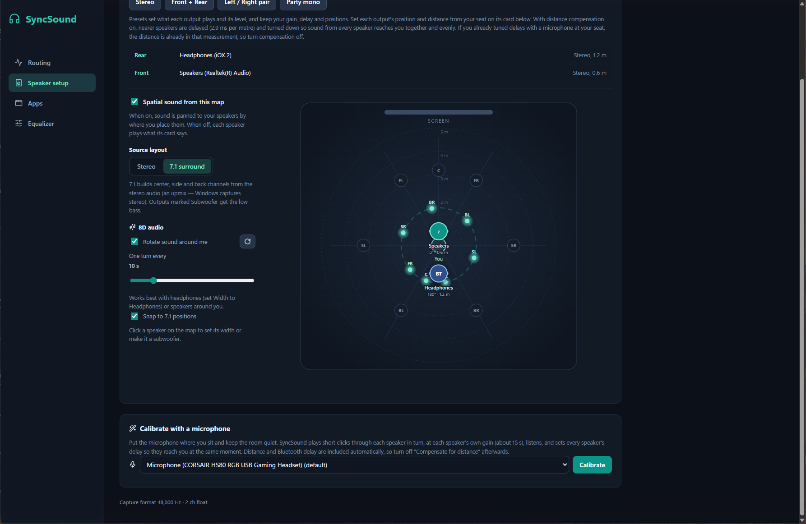
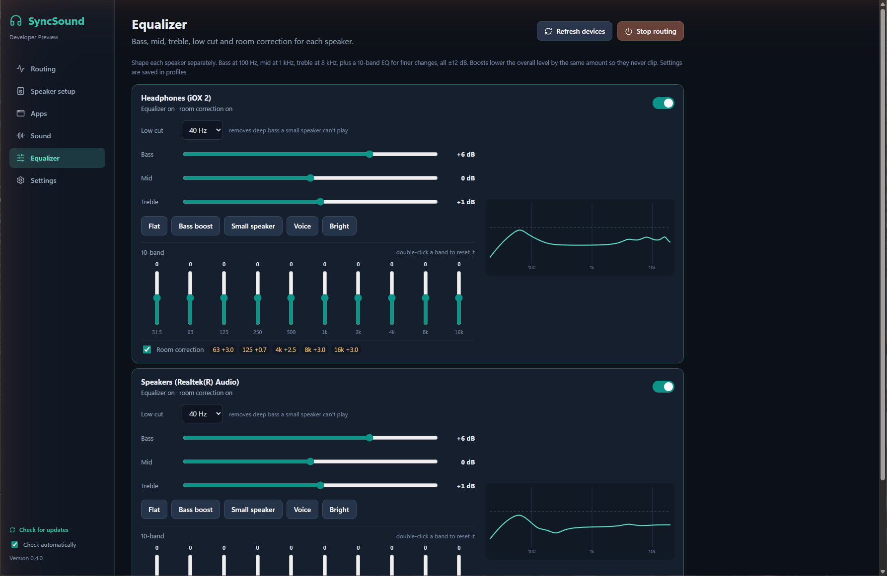
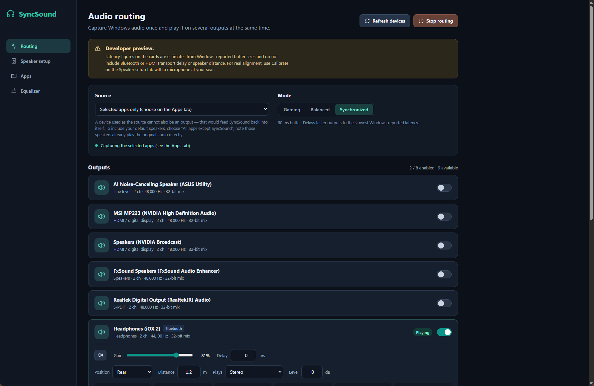
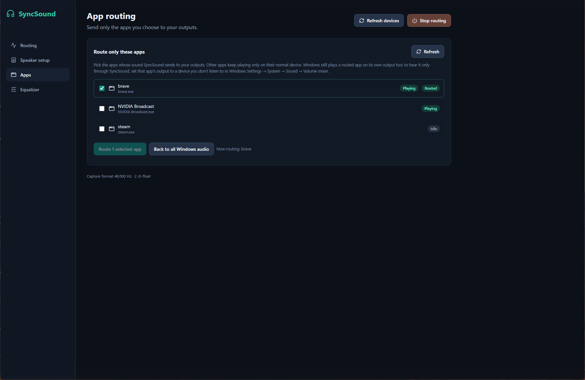
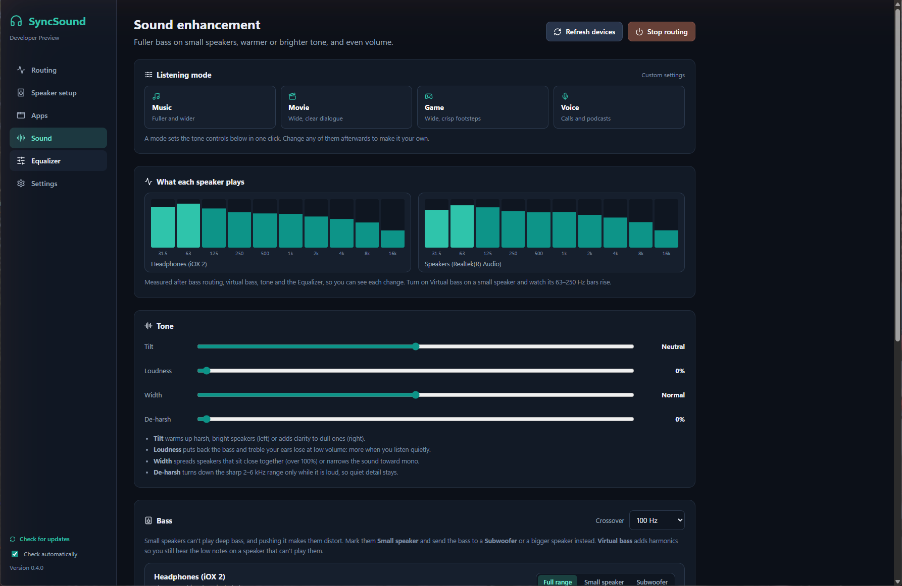

# SyncSound — play Windows audio on every speaker, in sync

**Status: developer preview.** SyncSound captures Windows audio with WASAPI loopback and plays it on up to eight outputs at once: wired, USB, HDMI and Bluetooth. Each output has its own buffer, drift correction, gain, mute, delay and EQ. A one-click microphone calibration measures when each speaker reaches your seat and sets the delays for you. The latency numbers on the output cards are Windows estimates; use Calibrate for measured alignment.

**[Download the latest release](https://github.com/KasunRocz-Softwares/SoundSync/releases/latest)** (Windows 11 x64) · [Website](https://kasunrocz-softwares.github.io/SoundSync/) · [Code signing policy](docs/CODE_SIGNING.md)

| Speaker setup: room map, 7.1 and 8D | Per-speaker equalizer |
|---|---|
|  |  |
| **Routing** | **Route only selected apps** |
|  |  |
| **Sound: listening modes, live spectrum, tone** | |
|  | |

## What works

- Render endpoint catalog with stable Windows endpoint IDs, default state, format, and best-effort connection type.
- Capture sources:
  - **Windows default output.** This source follows changes to the default device.
  - **Pinned output.** The source stays on one device. SyncSound never switches it to another device automatically.
  - **All apps except SyncSound.** This uses system-wide process-exclusion loopback.
- Feedback guard: an endpoint that is the capture source cannot also be an enabled output. Capture stops with a "Blocked" state instead of looping.
- Per-output event-driven WASAPI render worker. Each worker has its own bounded queue and fill-level drift correction (clamped, gradual resampling), manual delay (0–1000 ms), gain, mute, and float/integer sample formats.
- Gaming / Balanced / Synchronized modes. Synchronized mode delays faster outputs to the slowest Windows-reported device latency.
- Per-output recovery: a removed device retries with backoff (1 s up to 30 s, 8 attempts) without stopping the other outputs.
- Telemetry: buffered ms, estimated latency, drift correction ppm, underruns, and overruns.
- Versioned profiles stored in `%APPDATA%\cloud.syncsound.desktop\profiles`. Missing devices are listed and never matched by name. You rebind them explicitly.
- Diagnostics export (JSON, device IDs anonymised) to `%APPDATA%\cloud.syncsound.desktop\diagnostics`.

## Using it

1. Pick a **Source**. To hear audio on your normal speakers *and* other devices, choose **All apps except SyncSound**. Your default speakers already play the original audio directly. To keep everything aligned, set the Windows default output to a device you are not listening to, or leave it out of the enabled outputs.
2. Turn on the outputs you want, then select **Start routing**.
3. Use **Delay** to fine-tune by ear. Bluetooth devices usually need extra delay on the *other* outputs.

## Speaker setup

Each enabled output has four placement settings:

- **Position:** front, side or rear, left or right.
- **Distance:** how far it is from your seat, 0.2–20 m, optional.
- **Plays:** stereo, stereo with left and right swapped, left only, right only, or a mono mix.
- **Level:** a trim from 0 to −24 dB.

Presets set what each output plays and its level, and keep your gain, delay and positions:

| Preset | Effect |
|---|---|
| Stereo | Every output plays full stereo |
| Front + Rear | Outputs placed at the rear play 3 dB quieter; at least one must be set to Rear |
| Left / Right pair | Exactly two outputs form one stereo pair, assigned by their left/right positions |
| Party mono | Every output plays the same mono mix |

With **Compensate for distance** on, nearer speakers are delayed by 2.9 ms per metre and turned down by inverse distance (never below 25%). That way sound from every speaker reaches your seat together and evenly. If you tuned delays with a microphone at your seat, turn it off, because the measurement already includes distance. All of these settings are saved in profiles.

## Room map, 7.1 and 8D

The **Speaker setup** panel includes a top-down room map. You sit in the centre, the screen is at the top, and the standard 7.1 positions (C, FL, FR, SL, SR, BL, BR) are marked. Drag each enabled output to where it really is. It snaps to the 7.1 positions when it's within 10°. Distance rings run from 1 to 5 m.

Turn on **Spatial sound from this map** to pan the audio to your speakers by their position on the map (pairwise constant-power panning):

- **Stereo:** a virtual left and right channel at ±30°.
- **7.1 surround:** center, front, side and back channels built from the stereo capture. This is a matrix upmix; Windows loopback provides stereo, not discrete 7.1. Outputs marked **Subwoofer** get low-passed bass (about 120 Hz).
- **8D audio:** the whole virtual field rotates around you, one turn every 2–60 s, clockwise or counter-clockwise. The rotation follows the audio timeline, so every output turns in step.
- **Width:** single box, small stereo (±15°), wide pair (±45°) or headphones (±90°). Use Headphones on a single pair of headphones for the classic 8D effect.

Spatial mode changes only what each speaker plays. Delay, gain, level and alignment still apply. All settings are saved in profiles.

## Tabs

- **Routing:** source, mode, outputs (gain, mute, delay, position), profiles and diagnostics.
- **Speaker setup:** presets, the room map with 7.1 and 8D, and **Calibrate with a microphone**. Put a microphone at your seat, keep the room quiet, and press Calibrate. SyncSound plays clicks through each playing output in turn (about 6 s each) at that output's own gain. It finds when each output reaches the microphone and sets delays so all of them arrive together, with the smallest delay at 0. It needs at least two playing, unmuted outputs; outputs it can't hear clearly keep their delay. On the test setup it set the Realtek speaker to 255 ms behind the Bluetooth iOX 2; the manual measurement was 254 ms.
- **Apps:** route only the apps you pick (up to 8) instead of all Windows audio. Each app is captured with Windows process loopback, and several apps are mixed on a shared timeline. Apps are remembered by executable name and reconnect when they restart. Windows still plays those apps on their own output, so to hear them only through SyncSound, set the app's output to a device you don't listen to in Windows' Volume mixer.
- **Sound:** fuller sound on the speakers you already own.
  - **Listening modes:** Music, Movie, Game and Voice set the tone controls in one click. **Switch mode by app** picks a mode automatically while a chosen app (Spotify, a game…) is playing.
  - **Live spectrum:** octave-band levels of what each speaker actually plays, after every effect.
  - **Width** spreads close-together speakers or narrows toward mono; **De-harsh** turns down 2–6 kHz only while it is loud.
  - **Bass routing:** mark small speakers *Small speaker* and a bigger one *Subwoofer* or *Full range*; a Linkwitz-Riley crossover (60–150 Hz) sends the deep bass only where it can be played.
  - **Virtual bass:** adds harmonics of the missing bass so a small speaker still sounds like it has low notes.
  - **Tilt** (warm ↔ bright) and **Loudness**, which restores the bass and treble the ear loses at low volume.
  - **Even out volume:** slow automatic level, up to ±12 dB.
  - **Night mode:** compression that lifts dialogue and holds back explosions.
  - **Match speaker levels:** Calibrate delays also measures each speaker's level at your seat and turns the louder ones down.
- **Equalizer:** per output, low cut (40–150 Hz) for small speakers, bass (100 Hz), mid (1 kHz) and treble (8 kHz), plus a 10-band graphic EQ (31.5 Hz–16 kHz), each ±12 dB, with presets and a response curve. Room correction aims for a **Warm** (default) or **Flat** target; switching target re-aims the last measurement without measuring again. Boosts lower the level by the same amount so they can't clip.

## Requirements (Windows 11 x64)

- Node.js 22 or later and npm
- Rust stable (`x86_64-pc-windows-msvc`)
- Visual Studio 2022 Build Tools (Desktop development with C++, Windows SDK)
- Microsoft Edge WebView2 Runtime

## Develop

```powershell
npm ci
npm run desktop:dev
cargo test --workspace
# Native hardware smoke tests (outputs are muted):
cargo test -p syncsound-engine --test windows_capture --test windows_routing -- --ignored --nocapture --test-threads=1
```

## Build and install

```powershell
powershell -ExecutionPolicy Bypass -File .\scripts\build-windows.ps1
powershell -ExecutionPolicy Bypass -File .\scripts\install-windows.ps1 -InstallDir F:\SyncSound -Upgrade
```

The build script fails if either `target/release/bundle/nsis/*.exe` or `target/release/bundle/msi/*.msi` is missing. The install script installs the NSIS build silently into the given directory, launches it, re-installs it when `-Upgrade` is set, and checks that profile data in app data survives. Installers are unsigned.

## Download and updates

Download the latest `SyncSound_x.y.z_x64-setup.exe` from [Releases](https://github.com/KasunRocz-Softwares/SoundSync/releases/latest) and run it. Windows SmartScreen may warn because the installer has no code-signing certificate; choose **More info → Run anyway**.

SyncSound checks GitHub Releases for a newer version when it starts. You can turn this off, or check by hand, at the bottom of the sidebar. Updates are signed: the app installs only packages that verify against the public key built into it, then restarts. Your profiles stay in app data.

### Publishing a release (maintainers)

```powershell
powershell -ExecutionPolicy Bypass -File .\scripts\release.ps1 -Version 0.2.1 -Notes "What changed" -Publish
```

The script bumps the version, runs the tests, builds the NSIS and MSI installers signed with the updater key (`%USERPROFILE%\.tauri\syncsound-updater.key`, never committed), writes `latest.json`, tags the release and uploads it with `gh`. Back up the key. Without it, existing installs cannot accept future updates.

## Known limitations

- Windows process-exclusion loopback is system-wide. Excluding SyncSound while capturing one specific endpoint is not supported by the Windows API.
- Synchronization is estimated, not measured acoustically. Bluetooth codec/transport latency is not reported by Windows and must be compensated manually.
- Changing delay or mode causes a short audible jump on the affected outputs.
- The capture format is fixed at 48 kHz stereo float. Multichannel content is downmixed by Windows.
- Hardware checks for hotplug, sleep/resume, Bluetooth profile switches, and long sessions are listed as unverified in `docs/verification/2026-11-13-windows-release.md`.

## What SyncSound changes on your PC

- **Virtual speaker (optional, off by default):** turning it on makes the VB-CABLE device your Windows default playback device. SyncSound restores your previous default when you turn it off or quit. SyncSound does not install VB-CABLE; you install it yourself.
- **Start with Windows (optional, off by default):** adds a per-user startup entry, removed when you turn it off.
- **Update check:** downloads `latest.json` from this repository's GitHub Releases at start. Turn it off at the bottom of the sidebar.
- Settings and profiles live in `%APPDATA%\cloud.syncsound.desktop`. Uninstall from **Settings → Apps → Installed apps → SyncSound**.

## Code signing

[Code signing policy](docs/CODE_SIGNING.md). Free code signing provided by [SignPath.io](https://about.signpath.io), certificate by [SignPath Foundation](https://signpath.org).

## License

MIT. See [LICENSE](LICENSE).
